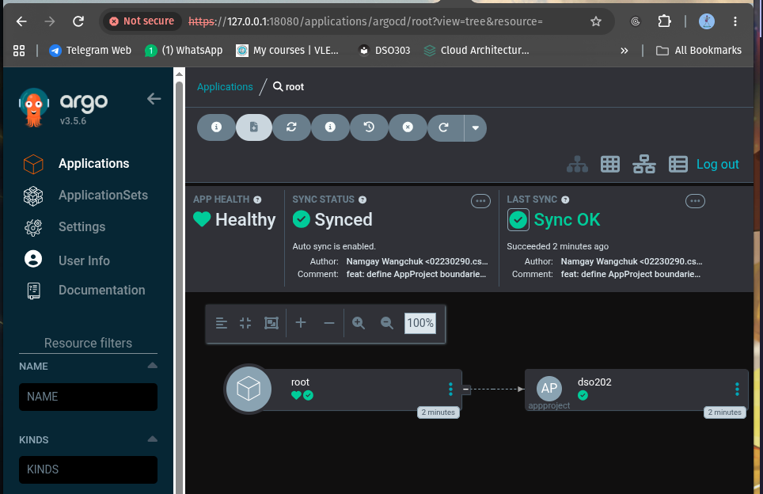

<!--
File        : docs/evidence.md
Assignment  : DSO202 Assignment 4
Purpose     : Records command outputs and verification evidence for each task.
-->

# DSO202 Assignment 4 — Evidence

## Task 1

### Repository, Chart Contract and Cluster

The Assignment 4 repository reuses the Helm chart from
Assignment 3, resource restrictions from Assignment 2,
and the Kind cluster configuration from Practical 1.

The namespace-scoped Role and RoleBinding manifests were
recreated because the original Assignment 2 RBAC manifests
were unavailable in the local assignment files.

### Chart Contract Verification

All chart file paths below are relative to charts/tasktracker/
unless otherwise stated.

| ID | Requirement | File and key | Result |
|---|---|---|---|
| C1 | Configurable image repositories and tags | values.yaml: database.image, backend.image, frontend.image; corresponding workload templates | PASS |
| C2 | Per-tier configuration rendered from values | values.yaml: database.env, backend.env, frontend.env; templates/configmap.yaml and workload envFrom references | PASS |
| C3 | Existing Secret references without rendering Secrets | values.yaml: existingSecret; templates/backend-deploy.yaml and templates/db-statefulset.yaml: secretKeyRef | PASS |
| C4 | Readiness probes on all three tiers | templates/backend-deploy.yaml: readinessProbe.httpGet.path=/api/status; templates/frontend-deploy.yaml: readinessProbe; templates/db-statefulset.yaml: readinessProbe.exec | PASS |
| C5 | Workload sync waves | templates/db-statefulset.yaml: wave 0; templates/backend-deploy.yaml: wave 1; templates/frontend-deploy.yaml: wave 2 | PASS |
| C6 | Rollout deadlines | templates/backend-deploy.yaml and templates/frontend-deploy.yaml: progressDeadlineSeconds=120 | PASS |
| C7 | Explicit resource requests and limits | values.yaml: database.resources, backend.resources, frontend.resources; corresponding workload templates | PASS |
| C8 | No platform resources rendered | templates/ contains only workload and application configuration resources; platform restrictions remain in platform/dev/ and platform/staging/ | PASS |
| C9 | Ingress disabled | values.yaml: ingress.enabled=false; no Ingress template or rendered Ingress | PASS |
| C10 | Environment-specific NodePorts | templates/frontend-deploy.yaml: service type and nodePort; environments/dev/values.yaml: 30080; environments/staging/values.yaml: 30081 | PASS |
| C11 | Helm lint and template rendering | Both environment values files successfully validated using helm lint and helm template | PASS |

The chart contract was verified through static rendering.
Live application readiness and rollout behaviour are tested
in the later deployment tasks.


### Tool Verification (Section 3.2)

```text
$ docker version --format "{{.Server.Version}}"
27.5.1

$ kind version
kind v0.32.0 go1.26.5 linux/amd64

$ kubectl version --client
Client Version: v1.36.3
Kustomize Version: v5.8.1

$ helm version --short
v4.3.0+gbec5b06

$ git --version
git version 2.34.1

$ argocd version --client
argocd: v3.5.6+c2b1e30
  BuildDate: 2026-10-20T19:01:52Z
  GitCommit: c2b1e3017e2cec86b122172e861dcd026453ae44
  GitTreeState: clean
  GoVersion: go1.26.10
  Compiler: gc
  Platform: linux/amd64

$ kubeseal --version
kubeseal version: 0.40.0

$ helm repo list
NAME          	URL                                     
hashicorp     	https://helm.releases.hashicorp.com     
kong          	https://charts.konghq.com               
bitnami       	https://charts.bitnami.com/bitnami      
podinfo       	https://stefanprodan.github.io/podinfo  
dso202-argo   	https://argoproj.github.io/argo-helm    
sealed-secrets	https://bitnami.github.io/sealed-secrets

$ helm search repo sealed-secrets/sealed-secrets --versions | head -5
NAME                         	CHART VERSION	APP VERSION	DESCRIPTION                                  
sealed-secrets/sealed-secrets	2.22.0       	0.41.2     	Helm chart for the sealed-secrets controller.
sealed-secrets/sealed-secrets	2.21.0       	0.41.2     	Helm chart for the sealed-secrets controller.
sealed-secrets/sealed-secrets	2.20.0       	0.40.0     	Helm chart for the sealed-secrets controller.
sealed-secrets/sealed-secrets	2.19.3       	0.39.1     	Helm chart for the sealed-secrets controller.
```

### Repository History

```text
$ git log --oneline --reverse
be2c43d chore: add gitignore to protect secrets and key material
089e074 docs: initialize DSO202 GitOps repository

$ git remote -v
origin	https://github.com/Namgay282004/dso202-gitops.git (fetch)
origin	https://github.com/Namgay282004/dso202-gitops.git (push)
```

### Kind Cluster Verification

```text
$ kind get clusters
dso202-gitops
kind

$ kubectl config current-context
kind-dso202-gitops

$ kubectl get nodes
NAME            STATUS   ROLES           AGE   VERSION
control-plane   Ready    control-plane   16d   v1.36.1
worker-node-1   Ready    <none>          16d   v1.36.1
worker-node-2   Ready    <none>          16d   v1.36.1

$ docker ps --filter name=dso202-gitops
dso202-gitops-worker2 
dso202-gitops-control-plane 127.0.0.1:30080->30080/tcp, 127.0.0.1:43441->6443/tcp
dso202-gitops-worker 
```

### Helm Lint and Template Verification

#### Environment: dev

```text
$ helm lint charts/tasktracker -f environments/dev/values.yaml
==> Linting charts/tasktracker
[INFO] Chart.yaml: icon is recommended

1 chart(s) linted, 0 chart(s) failed

$ helm template tasktracker charts/tasktracker --namespace dso202-dev -f environments/dev/values.yaml

$ grep "^kind:" rendered-manifest | sort | uniq -c
      3 kind: ConfigMap
      2 kind: Deployment
      3 kind: Service
      1 kind: StatefulSet
```

#### Environment: staging

```text
$ helm lint charts/tasktracker -f environments/staging/values.yaml
==> Linting charts/tasktracker
[INFO] Chart.yaml: icon is recommended

1 chart(s) linted, 0 chart(s) failed

$ helm template tasktracker charts/tasktracker --namespace dso202-staging -f environments/staging/values.yaml

$ grep "^kind:" rendered-manifest | sort | uniq -c
      3 kind: ConfigMap
      2 kind: Deployment
      3 kind: Service
      1 kind: StatefulSet
```


### Detailed Chart Contract Checks

#### Environment: dev

```text
$ grep -E "^[[:space:]]+image:" rendered-manifest
          image: "02230290namgay/dso202-backend:1.0"
          image: "02230290namgay/dso202-frontend:1.0"
          image: "02230290namgay/dso202-db:1.0"

$ grep -A 10 readinessProbe: rendered-manifest
          readinessProbe:
            httpGet:
              path: /api/status
              port: http
            initialDelaySeconds: 5
            periodSeconds: 5
            timeoutSeconds: 3
            failureThreshold: 3

          resources:
            limits:
--
          readinessProbe:
            httpGet:
              path: /
              port: http
            initialDelaySeconds: 5
            periodSeconds: 5
            timeoutSeconds: 3
            failureThreshold: 3

          resources:
            limits:
--
          readinessProbe:
            exec:
              command:
                - sh
                - -c
                - 'pg_isready -h 127.0.0.1 -U "$POSTGRES_USER" -d "$POSTGRES_DB"'
            initialDelaySeconds: 5
            periodSeconds: 5
            timeoutSeconds: 3
            failureThreshold: 6


$ grep sync-wave annotations and resource names
kind: ConfigMap
  name: tasktracker-database-config
    argocd.argoproj.io/sync-wave: "-1"
kind: ConfigMap
  name: tasktracker-backend-config
    argocd.argoproj.io/sync-wave: "-1"
kind: ConfigMap
  name: tasktracker-frontend-config
    argocd.argoproj.io/sync-wave: "-1"
kind: Service
  name: tasktracker-backend-service
    argocd.argoproj.io/sync-wave: "1"
kind: Service
  name: tasktracker-db-service
    argocd.argoproj.io/sync-wave: "0"
kind: Service
  name: tasktracker-frontend-service
    argocd.argoproj.io/sync-wave: "2"
kind: Deployment
  name: tasktracker-backend-deployment
    argocd.argoproj.io/sync-wave: "1"
kind: Deployment
  name: tasktracker-frontend-deployment
    argocd.argoproj.io/sync-wave: "2"
kind: StatefulSet
  name: tasktracker-db
    argocd.argoproj.io/sync-wave: "0"

$ grep progressDeadlineSeconds: rendered-manifest
  progressDeadlineSeconds: 120
  progressDeadlineSeconds: 120

$ grep -A 6 resources: rendered-manifest
          resources:
            limits:
              cpu: 500m
              memory: 512Mi
            requests:
              cpu: 200m
              memory: 256Mi
--
          resources:
            limits:
              cpu: 500m
              memory: 512Mi
            requests:
              cpu: 200m
              memory: 256Mi
--
          resources:
            limits:
              cpu: 500m
              memory: 512Mi
            requests:
              cpu: 200m
              memory: 256Mi
--
        resources:
          requests:
            storage: 1Gi

  persistentVolumeClaimRetentionPolicy:
    whenDeleted: Retain
    whenScaled: Retain

$ grep -A 2 secretKeyRef: rendered-manifest
                secretKeyRef:
                  name: "tasktracker-credentials"
                  key: DB_USER
--
                secretKeyRef:
                  name: "tasktracker-credentials"
                  key: DB_PASSWORD
--
                secretKeyRef:
                  name: "tasktracker-credentials"
                  key: POSTGRES_USER
--
                secretKeyRef:
                  name: "tasktracker-credentials"
                  key: POSTGRES_PASSWORD

$ grep NodePort configuration
  type: NodePort
      nodePort: 30080

$ Check forbidden resource kinds
PASS: No forbidden resources rendered
```

#### Environment: staging

```text
$ grep -E "^[[:space:]]+image:" rendered-manifest
          image: "02230290namgay/dso202-backend:1.0"
          image: "02230290namgay/dso202-frontend:1.0"
          image: "02230290namgay/dso202-db:1.0"

$ grep -A 10 readinessProbe: rendered-manifest
          readinessProbe:
            httpGet:
              path: /api/status
              port: http
            initialDelaySeconds: 5
            periodSeconds: 5
            timeoutSeconds: 3
            failureThreshold: 3

          resources:
            limits:
--
          readinessProbe:
            httpGet:
              path: /
              port: http
            initialDelaySeconds: 5
            periodSeconds: 5
            timeoutSeconds: 3
            failureThreshold: 3

          resources:
            limits:
--
          readinessProbe:
            exec:
              command:
                - sh
                - -c
                - 'pg_isready -h 127.0.0.1 -U "$POSTGRES_USER" -d "$POSTGRES_DB"'
            initialDelaySeconds: 5
            periodSeconds: 5
            timeoutSeconds: 3
            failureThreshold: 6


$ grep sync-wave annotations and resource names
kind: ConfigMap
  name: tasktracker-database-config
    argocd.argoproj.io/sync-wave: "-1"
kind: ConfigMap
  name: tasktracker-backend-config
    argocd.argoproj.io/sync-wave: "-1"
kind: ConfigMap
  name: tasktracker-frontend-config
    argocd.argoproj.io/sync-wave: "-1"
kind: Service
  name: tasktracker-backend-service
    argocd.argoproj.io/sync-wave: "1"
kind: Service
  name: tasktracker-db-service
    argocd.argoproj.io/sync-wave: "0"
kind: Service
  name: tasktracker-frontend-service
    argocd.argoproj.io/sync-wave: "2"
kind: Deployment
  name: tasktracker-backend-deployment
    argocd.argoproj.io/sync-wave: "1"
kind: Deployment
  name: tasktracker-frontend-deployment
    argocd.argoproj.io/sync-wave: "2"
kind: StatefulSet
  name: tasktracker-db
    argocd.argoproj.io/sync-wave: "0"

$ grep progressDeadlineSeconds: rendered-manifest
  progressDeadlineSeconds: 120
  progressDeadlineSeconds: 120

$ grep -A 6 resources: rendered-manifest
          resources:
            limits:
              cpu: 500m
              memory: 512Mi
            requests:
              cpu: 200m
              memory: 256Mi
--
          resources:
            limits:
              cpu: 500m
              memory: 512Mi
            requests:
              cpu: 200m
              memory: 256Mi
--
          resources:
            limits:
              cpu: 500m
              memory: 512Mi
            requests:
              cpu: 200m
              memory: 256Mi
--
        resources:
          requests:
            storage: 1Gi

  persistentVolumeClaimRetentionPolicy:
    whenDeleted: Retain
    whenScaled: Retain

$ grep -A 2 secretKeyRef: rendered-manifest
                secretKeyRef:
                  name: "tasktracker-credentials"
                  key: DB_USER
--
                secretKeyRef:
                  name: "tasktracker-credentials"
                  key: DB_PASSWORD
--
                secretKeyRef:
                  name: "tasktracker-credentials"
                  key: POSTGRES_USER
--
                secretKeyRef:
                  name: "tasktracker-credentials"
                  key: POSTGRES_PASSWORD

$ grep NodePort configuration
  type: NodePort
      nodePort: 30081

$ Check forbidden resource kinds
PASS: No forbidden resources rendered
```

### C2 — Configurable Backend Environment Test

```text
$ helm template with backend.env.GITOPS_CONTRACT_TEST=verified
  GITOPS_CONTRACT_TEST: "verified"

$ grep -A 3 envFrom: rendered-manifest
          envFrom:
            - configMapRef:
                name: tasktracker-backend-config

--
          envFrom:
            - configMapRef:
                name: tasktracker-frontend-config

--
          envFrom:
            - configMapRef:
                name: tasktracker-database-config


$ Check that the temporary test value is not saved
PASS: Test value was only used during rendering
```

### Repository Security Verification

| Security check | Result |
|---|---|
| All eight gitignore protection tests | PASS |
| Sensitive filename search | No matching files |
| Plaintext Secret manifest search | No matches |
| Private key search | No matches |
| Previous credential value search | No matches |
| Potential hardcoded credential search | No matches |
| Reachable Git history credential search | No matches |

The initial Git history was inspected before committing
the application configuration.

Actual verification output:

```text
===== CORRECTED PRIVATE KEY SEARCH =====
PASS: No private keys found

===== GIT HISTORY CREDENTIAL SEARCH =====
===== GIT HISTORY FILES =====
.gitignore
README.md
```

These checks reduce the risk of accidentally exposing plaintext
credentials and private key material in the public repository.
They are not a guarantee that every possible secret format has
been detected.


---

## Task 2 — Install Argo CD Declaratively

### 1. Objective

Install Argo CD using a version-controlled Kustomize configuration
with a pinned upstream release and local configuration patches.

Mapped descriptors: 4.1.2, 4.2.1, Unit III 3.1.4.
Learning outcomes: LO 6 and LO 7.

### 2. Declarative bootstrap configuration

| File | Purpose |
|---|---|
| bootstrap/argocd/namespace.yaml | Creates the argocd namespace |
| bootstrap/argocd/kustomization.yaml | References the pinned Argo CD v3.5.6 installation |
| bootstrap/argocd/argocd-cm-patch.yaml | Configures reconciliation, reviewer login and Application health |
| bootstrap/argocd/argocd-rbac-cm-patch.yaml | Defines the restricted reviewer permissions and empty default policy |

The upstream installation manifest is pinned to:

https://raw.githubusercontent.com/argoproj/argo-cd/v3.5.6/manifests/install.yaml

### 3. Kustomize rendering verification

Command:

```bash
kubectl kustomize bootstrap/argocd > /tmp/argocd-rendered.yaml
wc -l /tmp/argocd-rendered.yaml
```

Actual output:

```text
34132 /tmp/argocd-rendered.yaml
```

#### 3.1 Rendered workload kinds

Command:

```bash
grep -E '^kind: (Deployment|StatefulSet)$' /tmp/argocd-rendered.yaml
```

Actual output:

```text
kind: Deployment
kind: Deployment
kind: Deployment
kind: Deployment
kind: Deployment
kind: Deployment
kind: StatefulSet
```

Workload count:

```bash
grep -E '^kind: (Deployment|StatefulSet)$' \
  /tmp/argocd-rendered.yaml | sort | uniq -c
```

```text
      6 kind: Deployment
      1 kind: StatefulSet
```

Result: PASS. Six Deployments and one StatefulSet were rendered.

#### 3.2 Rendered container images

Command:

```bash
grep 'image:' /tmp/argocd-rendered.yaml | sort -u
```

Actual output:

```text
        image: ghcr.io/dexidp/dex:v2.45.1
        image: public.ecr.aws/docker/library/redis:8.2.3-alpine
        image: quay.io/argoproj/argocd:v3.5.6
```

Result: PASS. All three images use explicit version tags and the
expected image registries. None is retrieved from Docker Hub.

#### 3.3 Namespace verification

Command:

```bash
grep -E '^  namespace:' \
  /tmp/argocd-rendered.yaml | sort | uniq -c
```

Actual output:

```text
     59   namespace: argocd
```

All namespace declarations matched by the command reference argocd.

#### 3.4 Rendered configuration patches

Actual output:

```yaml
accounts.reviewer: login
resource.customizations.health.argoproj.io_Application: |
timeout.reconciliation: 60s
timeout.reconciliation.jitter: 10s
```

Rendered RBAC configuration excerpt:

```text
p, reviewer, applications, get, dso202/*, allow
p, reviewer, projects, get, dso202, allow
policy.default: ""
```

Result: PASS. The expected configuration patches are present.

### 4. Server-side installation

Installation command:

```bash
kubectl apply -k bootstrap/argocd \
  --server-side --force-conflicts
```

Server-side apply was used because the ApplicationSet CRD exceeds
the 262144-byte annotation size limit associated with ordinary
client-side apply.

The installation was verified through Deployment availability,
StatefulSet readiness, running Pods and registered CRDs.

### 5. Workload readiness verification

Command:

```bash
kubectl wait --for=condition=Available deployment --all \
  -n argocd --timeout=300s
```

Final successful output:

```text
deployment.apps/argocd-applicationset-controller condition met
deployment.apps/argocd-dex-server condition met
deployment.apps/argocd-notifications-controller condition met
deployment.apps/argocd-redis condition met
deployment.apps/argocd-repo-server condition met
deployment.apps/argocd-server condition met
```

StatefulSet verification:

```bash
kubectl rollout status \
  statefulset/argocd-application-controller \
  -n argocd --timeout=300s
```

Actual output:

```text
partitioned roll out complete: 1 new pods have been updated...
```

#### 5.1 Final Pod status

Command:

```bash
kubectl get pods -n argocd
```

Actual output:

```text
NAME                                                READY   STATUS    RESTARTS   AGE
argocd-application-controller-0                     1/1     Running   0          19m
argocd-applicationset-controller-58bb5c7479-48nwb   1/1     Running   0          19m
argocd-dex-server-dd6b85d9c-hwj74                   1/1     Running   0          19m
argocd-notifications-controller-6b85c65458-qts6z    1/1     Running   0          19m
argocd-redis-869b85489d-7f9wl                       1/1     Running   0          19m
argocd-repo-server-5bf66565cd-98k2t                 1/1     Running   0          19m
argocd-server-7474bb8f76-gtmlm                      1/1     Running   0          19m
```

Result: PASS. All seven Pods are Running and Ready with zero restarts.

#### 5.2 CRD verification

Command:

```bash
kubectl get crd | grep argoproj.io
```

Actual output:

```text
applications.argoproj.io      2026-11-21T19:10:55Z
applicationsets.argoproj.io   2026-11-21T19:10:55Z
appprojects.argoproj.io       2026-11-21T19:10:56Z
```

Result: PASS. All three required CRDs exist.

### 6. Argo CD access and authentication

The following port-forward command was used:

```bash
kubectl port-forward --address 127.0.0.1 \
  svc/argocd-server -n argocd 18080:443
```

CLI authentication command:

```bash
argocd login 127.0.0.1:18080 --username admin --insecure
```

Authentication verification:

```bash
argocd account get-user-info
```

Actual output:

```text
Logged In: true
Username: admin
Issuer: argocd
Groups:
```

Browser access:

https://127.0.0.1:18080/applications

The self-signed TLS certificate warning was accepted for the local
installation. No credentials are included in the evidence.

#### 6.1 Authenticated Argo CD dashboard


The dashboard displayed Argo CD v3.5.6 and an empty Applications
view. This is expected because the root Application and AppProjects
are created in Task 3.

### 7. Applied configuration verification

Command:

```bash
kubectl get configmap argocd-cm -n argocd -o yaml \
  | grep -E 'timeout.reconciliation|accounts.reviewer|resource.customizations.health'
```

Actual output:

```yaml
  accounts.reviewer: login
  resource.customizations.health.argoproj.io_Application: |
  timeout.reconciliation: 60s
  timeout.reconciliation.jitter: 10s
```

Result: PASS. The expected settings are present in the running
Argo CD installation.

#### 7.1 Applied RBAC configuration

Command:

```bash
kubectl get configmap argocd-rbac-cm -n argocd -o yaml \
  | grep -E 'policy.default:|p, reviewer,'
```

Actual output:

```text
    p, reviewer, applications, get, dso202/*, allow
    p, reviewer, projects, get, dso202, allow
  policy.default: ""
```

Result: PASS. The configured reviewer permissions match the
bootstrap policy. Permission enforcement will be tested in Task 6.

### 8. Argo CD version verification

Command:

```bash
argocd version
```

Actual output:

```text
argocd: v3.5.6+c2b1e30
  BuildDate: 2026-10-20T19:01:52Z
  GitCommit: c2b1e3017e2cec86b122172e861dcd026453ae44
  GitTreeState: clean
  GoVersion: go1.26.10
  Compiler: gc
  Platform: linux/amd64
argocd-server: v3.5.6
  BuildDate: 2026-10-20T18:33:20Z
  GitCommit: c2b1e3017e2cec86b122172e861dcd026453ae44
  GitTreeState: clean
  GitTag: v3.5.6
  GoVersion: go1.26.10
  Compiler: gc
  Platform: linux/amd64
  Kustomize Version: v5.8.1 2026-02-09T16:15:27Z
  Helm Version: v4.2.1+gd591a19
  Kubectl Version: v0.36.1
  Jsonnet Version: v0.22.0
```

Result: PASS. Both the Argo CD client and server use v3.5.6
and the same Git commit.

### 9. Troubleshooting and environmental observations

#### 9.1 Docker memory allocation

Docker reported 3.675 GiB of available VM memory, below the
recommended 6 GB allocation.

An unused Kind cluster was stopped without deleting it. This
released approximately 1.88 GiB of reported container memory.

The Assignment 4 cluster retained all three Ready nodes.
Docker memory allocation was not changed.

During Argo CD initialization, the three Assignment 4 node
containers reported the following memory usage:

| Node | Memory usage |
|---|---:|
| Control plane | 952.8 MiB |
| Worker node 1 | 378.7 MiB |
| Worker node 2 | 325.4 MiB |
| Total | 1656.9 MiB |

No warning events were reported during the diagnostic check.
The lower Docker memory allocation remains a consideration
for subsequent application deployments.

#### 9.2 Initial Deployment readiness timeout

The initial 300-second readiness check timed out while
container images were still downloading.

Six Pods eventually became Running and Ready, while the Dex
server remained in PodInitializing.

Pod inspection confirmed:

- The Pod was successfully scheduled on worker-node-2.
- The copyutil init container completed with exit code 0.
- The Dex container image was still downloading.
- No container restarts or warning events were reported.

The final Kubernetes events recorded these image pull durations:

| Image | Pull duration |
|---|---|
| Argo CD v3.5.6 (Dex init container) | 4m25.589s |
| Redis 8.2.3-alpine | 56.022s |
| Dex v2.45.1 | 11m30.238s |

Corrective action:

```bash
kubectl wait --for=condition=Available \
  deployment/argocd-dex-server \
  -n argocd --timeout=600s
```

Actual output:

```text
deployment.apps/argocd-dex-server condition met
```

The final readiness check confirmed all seven Pods were
Running and Ready with zero restarts.

No manifest changes, Pod deletion or cluster recreation
were required.

#### 9.3 Local port conflicts

The original local port 8080 was occupied by the existing
model-router Docker container.

```text
model-router    0.0.0.0:8080->80/tcp
```

The alternative port 8081 was also occupied by a docker-proxy
process.

The following ports were checked:

```text
Port 8080: OCCUPIED
Port 8081: OCCUPIED
Port 8082: OCCUPIED
Port 8083: OCCUPIED
Port 8085: AVAILABLE
Port 8888: AVAILABLE
Port 9090: AVAILABLE
Port 18080: AVAILABLE
```

Local port 18080 was selected for Argo CD access, preserving
the existing applications and services.

Binding explicitly to 127.0.0.1 also avoided the IPv6
listener error.

This change affects only local port forwarding. It does not
modify the Kubernetes Service, Argo CD manifests or GitOps
architecture.

### 10. Task 2 verification summary

| Requirement | Result |
|---|---|
| Version-controlled Kustomize bootstrap | PASS |
| Pinned Argo CD release v3.5.6 | PASS |
| Six rendered Deployments | PASS |
| One rendered StatefulSet | PASS |
| Expected container images | PASS |
| Server-side installation | PASS |
| Seven Running and Ready Pods | PASS |
| Three required CRDs | PASS |
| CLI authentication | PASS |
| Browser authentication | PASS |
| Applied ConfigMap settings | PASS |
| Applied reviewer RBAC configuration | PASS |
| Client and server version verification | PASS |
| Required authenticated UI screenshot | PASS |

### 11. Conclusion

Argo CD v3.5.6 was installed declaratively using Kustomize
and server-side apply on the existing dso202-gitops Kind
cluster.

All seven components are healthy, the required CRDs exist,
and the local configuration patches are present.

Both CLI and browser authentication were verified.
The initial image download delay and local port conflicts
were resolved without modifying the installation or
disrupting existing applications.

The Argo CD installation is ready for Task 3, which introduces
AppProjects and the root Application.


---

## Task 3 — AppProjects and the Root Application

### 3.1 Objective

The objective of this task is to establish administrative and workload
security boundaries using Argo CD AppProjects and implement the App-of-Apps
bootstrap pattern.

The root Application is the only Application created manually. It monitors
the argocd/ directory in the Git repository and automatically creates
the AppProjects and Applications defined there.

### 3.2 Chart Resource Kind Verification

The Task Tracker Helm chart was rendered for both development and staging
before defining the restricted AppProject.

Commands:

```bash
helm template tasktracker-dev charts/tasktracker \
  -f environments/dev/values.yaml | grep '^kind:' | sort | uniq -c

helm template tasktracker-staging charts/tasktracker \
  -f environments/staging/values.yaml | grep '^kind:' | sort | uniq -c
```

Both environments returned:

```text
      3 kind: ConfigMap
      2 kind: Deployment
      3 kind: Service
      1 kind: StatefulSet
```

Total resources rendered per environment: 9.

Forbidden resource checks returned the following result for both environments:

```text
PASS: No forbidden resource kinds rendered
```

The Helm chart does not render Namespace, ResourceQuota, LimitRange,
Role, RoleBinding, SealedSecret or Secret resources.

Platform resources remain separate from application workloads.

### 3.3 Final Restricted Resource Whitelist

The final workload whitelist is defined in argocd/projects/dso202.yaml.

| API Group | Resource Kind | Reason |
|-----------|---------------|--------|
| apps | Deployment | Backend and frontend workloads |
| apps | StatefulSet | Persistent database workload |
| Core | Service | Network access to application tiers |
| Core | ConfigMap | External configuration |
| batch | Job | Required smoke-test hook in Task 5 |

The ServiceAccount entry from the reference listing was omitted because
the current Helm chart does not render a ServiceAccount.

The Job entry is retained because it is explicitly required for the
smoke-test hook in Task 5.

No additional resource kinds were introduced.

Final live namespaced whitelist:

```json
[
  {
    "group": "apps",
    "kind": "Deployment"
  },
  {
    "group": "apps",
    "kind": "StatefulSet"
  },
  {
    "group": "",
    "kind": "Service"
  },
  {
    "group": "",
    "kind": "ConfigMap"
  },
  {
    "group": "batch",
    "kind": "Job"
  }
]
```

Final live cluster resource whitelist:

```json
[]
```

The empty cluster resource whitelist prevents the workload project from
deploying cluster-scoped resources.

Verified AppProject sync wave:

```text
-3
```

### 3.4 AppProject Security Boundaries

Two AppProjects were defined according to Listings 6 and 8.

| Property | platform | dso202 |
|----------|----------|--------|
| Purpose | Administrative platform resources | Task Tracker workloads |
| Source repositories | 2 | 1 |
| Destination namespaces | 4 | 2 |
| Deploy into argocd | Allowed | Not allowed |
| Deploy into sealed-secrets | Allowed | Not allowed |
| Deploy into dso202-dev | Allowed | Allowed |
| Deploy into dso202-staging | Allowed | Allowed |
| Cluster-scoped resources | All permitted | None permitted |
| Namespaced resource whitelist | Unrestricted | Five resource kinds |
| Creation method | Manual bootstrap | Root Application |

The platform project allows the following repositories:

- https://github.com/Namgay282004/dso202-gitops.git
- https://bitnami.github.io/sealed-secrets

The dso202 project allows only:

- https://github.com/Namgay282004/dso202-gitops.git

The live configuration confirms the intended administrative and workload
security boundaries.

### 3.5 Configuration Files

The following files were created:

```text
bootstrap/root/platform-project.yaml
bootstrap/root/root-app.yaml
argocd/projects/dso202.yaml
```

The files implement Listings 6, 7 and 8 respectively.

All files include assignment headers explaining their purpose.

The GitHub username placeholders were replaced with the actual repository
owner.

### 3.6 Server-Side Manifest Validation

Each configuration file was validated individually before deployment.

Combined validation command:

```bash
kubectl apply --dry-run=server \
  -f bootstrap/root/platform-project.yaml \
  -f bootstrap/root/root-app.yaml \
  -f argocd/projects/dso202.yaml
```

Observed output:

```text
appproject.argoproj.io/platform created (server dry run)
Warning: metadata.finalizers: "resources-finalizer.argocd.argoproj.io": prefer a domain-qualified finalizer name including a path (/) to avoid accidental conflicts with other finalizer writers
application.argoproj.io/root created (server dry run)
appproject.argoproj.io/dso202 created (server dry run)
```

All three manifests passed server-side validation.

The finalizer warning is a Kubernetes naming recommendation.
The Argo CD finalizer was retained because it is required for cascading
deletion and is specified in the assignment reference configuration.

Whitespace validation returned no warnings.

No resources were created during the dry-run operations.

### 3.7 Security Verification Before Git Push

The following targeted security checks were performed against the new
Task 3 configuration files:

```text
PASS: No plaintext Secret resources
PASS: No private key material
PASS: No matching hardcoded credential fields
PASS: All GitHub username placeholders replaced
```

Only the three intended Task 3 configuration files were staged.

Git change summary:

```text
argocd/projects/dso202.yaml          | 49 insertions
bootstrap/root/platform-project.yaml | 47 insertions
bootstrap/root/root-app.yaml         | 56 insertions
3 files changed, 152 insertions(+)
```

### 3.8 Git Commit Before Bootstrap

The configuration was committed and pushed to main before creating the
root Application, as required by the assignment.

Commit:

```text
50f3cab feat: define AppProject boundaries and root GitOps Application
```

Full commit SHA:

```text
50f3cabda6259241e78589680044c9b6b9946806
```

The local and remote main commit SHAs were identical.

Before bootstrap, the cluster contained only the default AppProject
and no Applications.

### 3.9 Environment Readiness and Recovery Observation

Before creating the Task 3 resources, the Kubernetes cluster and
Argo CD components were checked.

Following a restart of the cluster containers, the Redis Pod briefly
reported an Unknown state and the previous port-forward connection
was unavailable.

Redis recovered automatically. The temporary initialization failure
was followed by successful initialization and container startup.

No Pods were manually deleted, no cluster was recreated and no
configuration changes were required.

All three Kubernetes nodes returned to Ready status.

All six Argo CD Deployments became Available:

```text
deployment.apps/argocd-applicationset-controller condition met
deployment.apps/argocd-dex-server condition met
deployment.apps/argocd-notifications-controller condition met
deployment.apps/argocd-redis condition met
deployment.apps/argocd-repo-server condition met
deployment.apps/argocd-server condition met
```

All seven Argo CD Pods were Running and Ready.

The port-forward connection was restored using:

```bash
kubectl port-forward --address 127.0.0.1 \
  svc/argocd-server -n argocd 18080:443
```

CLI authentication was verified:

```text
Logged In: true
Username: admin
Issuer: argocd
Groups:
```

Argo CD client and server versions:

```text
argocd: v3.5.6+c2b1e30
argocd-server: v3.5.6
```

The recovery observation demonstrates environment readiness.
It is not counted as one of the controlled failure drills required
in Task 8.

### 3.10 Root Application Bootstrap

The active Kubernetes context was:

```text
kind-dso202-gitops
```

After the configuration was successfully pushed to GitHub, the two
bootstrap files were applied using the official command:

```bash
kubectl apply -f bootstrap/root
```

Observed output:

```text
appproject.argoproj.io/platform created
Warning: metadata.finalizers: "resources-finalizer.argocd.argoproj.io": prefer a domain-qualified finalizer name including a path (/) to avoid accidental conflicts with other finalizer writers
application.argoproj.io/root created
```

Repeating the same command returned:

```text
appproject.argoproj.io/platform unchanged
application.argoproj.io/root unchanged
```

The restricted dso202 AppProject was not manually applied.

The root Application automatically retrieved the argocd/ directory
from the main branch and created the restricted AppProject.

### 3.11 Automatic Synchronization Results

The root Application reached the following status:

```text
NAME   SYNC STATUS   HEALTH STATUS
root   Synced        Healthy
```

The synchronization wait command confirmed a successful operation.

Observed synchronization details:

```text
Operation:          Sync
Sync Revision:      50f3cabda6259241e78589680044c9b6b9946806
Phase:              Succeeded
Start:              2026-11-22 12:35:42 +0600 +06
Finished:           2026-11-22 12:35:43 +0600 +06
Duration:           1s
Message:            successfully synced (all tasks run)
```

No manual synchronization was required.

### 3.12 Official Verification Command 1

Command:

```bash
kubectl get appproject,application -n argocd
```

Observed output:

```text
NAME                              AGE
appproject.argoproj.io/default    11h
appproject.argoproj.io/dso202     19s
appproject.argoproj.io/platform   39s

NAME                           SYNC STATUS   HEALTH STATUS
application.argoproj.io/root   Synced        Healthy
```

All three expected AppProjects exist.

The root Application is Synced and Healthy.

### 3.13 Official Verification Command 2

Command:

```bash
argocd app get root
```

Observed output:

```text
Name:               argocd/root
Project:            platform
Server:             https://kubernetes.default.svc
Namespace:          argocd
URL:                https://127.0.0.1:18080/applications/root
Source:
- Repo:             https://github.com/Namgay282004/dso202-gitops.git
  Target:           main
  Path:             argocd
SyncWindow:         Sync Allowed
Sync Policy:        Automated (Prune)
Sync Status:        Synced to main (50f3cab)
Health Status:      Healthy

GROUP        KIND        NAMESPACE  NAME    STATUS  HEALTH  HOOK  MESSAGE
argoproj.io  AppProject  argocd     dso202  Synced                appproject.argoproj.io/dso202 created
```

The managed resource list proves that the dso202 AppProject was
created by the root Application.

### 3.14 Official Verification Command 3

Command:

```bash
argocd proj get dso202
```

Observed output:

```text
Name:                        dso202
Description:                 Task Tracker workloads for the dev and staging environments
Destinations:                https://kubernetes.default.svc,dso202-dev
                             https://kubernetes.default.svc,dso202-staging
Repositories:                https://github.com/Namgay282004/dso202-gitops.git
Source Namespaces:           <none>
Scoped Repositories:         <none>
Allowed Cluster Resources:   <none>
Scoped Clusters:             <none>
Denied Namespaced Resources: <none>
Signature keys:              <none>
Orphaned Resources:          disabled
```

The project permits only the two intended destination namespaces and
the specified Git repository.

The namespace resource whitelist was also inspected directly from the
live AppProject specification because the CLI summary does not display
the allowed namespaced resource list.

### 3.15 GitOps Ownership Verification

Command:

```bash
kubectl get application root -n argocd \
  -o json | jq '.status.resources'
```

Observed output:

```json
[
  {
    "group": "argoproj.io",
    "kind": "AppProject",
    "name": "dso202",
    "namespace": "argocd",
    "status": "Synced",
    "syncWave": -3,
    "version": "v1alpha1"
  }
]
```

The dso202 AppProject is managed by the root Application.

### 3.16 Automatic Synchronization Configuration

Command:

```bash
kubectl get application root -n argocd \
  -o json | jq '.spec.syncPolicy'
```

Observed output:

```json
{
  "automated": {
    "prune": true,
    "selfHeal": true
  },
  "retry": {
    "backoff": {
      "duration": "10s",
      "factor": 2,
      "maxDuration": "3m"
    },
    "limit": 5
  }
}
```

Automatic pruning, self-healing and exponential retry backoff
are correctly configured.

The synchronized Git revision and the local Git revision were both:

```text
50f3cabda6259241e78589680044c9b6b9946806
```

This confirms that the live root Application synchronized with the
intended Git commit.

### 3.17 Required Screenshot

**Screenshot 09 — Root Application Resource Tree**



The screenshot demonstrates:

- Argo CD version v3.5.6.
- Root Application health: Healthy.
- Root Application sync status: Synced.
- Last synchronization: Sync OK.
- Automatic synchronization enabled.
- The dso202 AppProject displayed as a managed resource.

Screenshot file verification:

```text
Filename: 09-root-application-resource-tree.png
Size: 123K
Format: PNG
Resolution: 964 x 624
```

### 3.18 Written Answer Q1

The written answer to Question 1 is provided in the repository README.

It explains why the platform AppProject must be manually bootstrapped,
why the restricted dso202 AppProject is created through the root
Application, and the security risk of permitting workload Applications
to deploy into the argocd namespace.

### 3.19 Task 3 Summary

| Requirement | Result |
|-------------|--------|
| Chart resource kinds compared with whitelist | Passed |
| Platform AppProject defined | Passed |
| Root Application defined | Passed |
| Restricted AppProject defined | Passed |
| All manifests validated | Passed |
| Configuration pushed before bootstrap | Passed |
| Platform and root manually bootstrapped | Passed |
| Restricted project automatically created | Passed |
| Root Application Synced and Healthy | Passed |
| Live security boundaries verified | Passed |
| Git revision verified | Passed |
| Required resource tree screenshot | Captured |
| Written answer Q1 | Included in README |

Task 3 establishes the GitOps administrative boundary and automated
Application management required for the following tasks.

From this point onward, new Applications and AppProjects are introduced
through Git rather than being created manually.


---

## Task 4 — Sealed Secrets and Platform Applications

### 4.1 Objective

Deploy the Sealed Secrets controller through GitOps, securely encrypt
environment-specific database credentials, and establish the development
and staging platform environments without committing plaintext secrets
or private sealing keys to Git.

Implementation and verification date: 22 November 2026.

### 4.2 Environment and tool verification

| Component | Verified configuration |
|---|---|
| Kubernetes context | kind-dso202-gitops |
| Argo CD version | v3.5.6 |
| kubeseal version | 0.40.0 |
| Sealed Secrets Helm chart | 2.20.0 |
| Sealed Secrets controller | 0.40.0 |
| Controller namespace | sealed-secrets |
| Controller Application sync wave | -2 |
| Platform Application sync wave | -1 |
| Controller Helm repository | https://bitnami.github.io/sealed-secrets |
| Git repository | https://github.com/Namgay282004/dso202-gitops.git |

The existing Kubernetes cluster and Argo CD installation were reused.

Before starting Task 4, a duplicate Task 3 evidence section was removed
without changing the existing implementation or losing evidence.

Documentation correction commit:

    951da70 docs: remove duplicate Task 3 evidence section

### 4.3 Sealed Secrets controller Application

The controller Application was defined in:

    argocd/applications/sealed-secrets.yaml

The configuration follows Listing 9 of the assignment guide.

| Configuration | Value |
|---|---|
| Application name | sealed-secrets |
| AppProject | platform |
| Helm chart | sealed-secrets |
| Chart revision | 2.20.0 |
| Helm release name | sealed-secrets |
| fullnameOverride | sealed-secrets-controller |
| Destination namespace | sealed-secrets |
| Sync wave | -2 |
| Automated synchronization | Enabled |
| Pruning | Enabled |
| Self-healing | Enabled |
| CreateNamespace | true |
| Retry limit | 5 |

Server-side dry-run validation passed.

The Helm rendering contained the following resource kinds:

    1 ClusterRole
    1 ClusterRoleBinding
    1 CustomResourceDefinition
    1 Deployment
    2 Role
    2 RoleBinding
    2 Service
    1 ServiceAccount

The controller image was verified as:

    docker.io/bitnami/sealed-secrets-controller:0.40.0

The pinned chart and controller versions satisfy the assignment
version requirements.

### 4.4 Official Step 1 — Controller installation evidence

The controller Application was committed and pushed to Git.

Commit:

    b952eb2 feat: deploy pinned Sealed Secrets controller through GitOps

Full revision:

    b952eb2dc287f944a956c1ba7603697b5b1a01ba

The root Application automatically discovered and created the
sealed-secrets Application.

Command:

    kubectl get applications -n argocd

Output:

    NAME             SYNC STATUS   HEALTH STATUS
    root             Synced        Healthy
    sealed-secrets   Synced        Healthy

Command:

    kubectl get pods -n sealed-secrets

Recorded output:

    NAME                                        READY   STATUS    RESTARTS
    sealed-secrets-controller-8b5ffdf69-np7ch   1/1     Running   0

Command:

    kubectl get crd sealedsecrets.bitnami.com

Recorded result:

    NAME                        CREATED AT
    sealedsecrets.bitnami.com   2026-11-22T06:48:15Z

Additional verification:

- Controller Deployment: 1/1 Ready.
- Controller Deployment rollout: successful.
- SealedSecret CRD condition: Established.
- Application synchronization operation: Succeeded.
- Synchronization duration: 5 seconds.
- Controller namespace automatically created.
- No manual controller Application creation was performed.

The root Application managed the controller installation through Git.

### 4.5 Official Step 2 — Private sealing key backup

The controller generated a Kubernetes TLS Secret containing its
sealing key and certificate.

The sealing key was backed up before any credentials were encrypted.

Commands:

    mkdir -p ../dso202-keys
    chmod 700 ../dso202-keys

    kubectl get secret -n sealed-secrets \
      -l sealedsecrets.bitnami.com/sealed-secrets-key \
      -o yaml > ../dso202-keys/sealing-key.backup.yaml

    chmod 600 ../dso202-keys/sealing-key.backup.yaml

The backup was created using a restrictive umask.

Command:

    ls -l ../dso202-keys/

Recorded output:

    total 8
    -rw------- 1 namgaywangchuk namgaywangchuk 7089 Nov 22 12:51 sealing-key.backup.yaml

Verification summary:

| Check | Result |
|---|---|
| Backup directory outside Git repository | PASS |
| Backup directory permissions | 700 |
| Backup file permissions | 600 |
| Backup file size | 7089 bytes |
| Backup file is non-empty | PASS |
| Private key field exists | PASS |
| Certificate field exists | PASS |
| Private key backup tracked by Git | No |
| Private key contents displayed | No |

The backup is stored outside the public repository.

The private key and certificate contents are intentionally excluded
from this evidence document.

Actual key restoration and recovery will be demonstrated in Task 9.

### 4.6 Official Step 3 — Plaintext credential preparation

Two temporary credential input files were created:

    secrets-plain/dev.env
    secrets-plain/staging.env

Both contained the four required credential keys:

    DB_USER
    DB_PASSWORD
    POSTGRES_USER
    POSTGRES_PASSWORD

The files were protected using permission 600 and excluded
from Git through .gitignore.

Validation results:

| Check | Development | Staging |
|---|---|---|
| File exists | PASS | PASS |
| Valid KEY=value format | PASS | PASS |
| Exactly four required keys | PASS | PASS |
| Non-empty credential values | PASS | PASS |
| Example placeholders replaced | PASS | PASS |
| DB_USER equals POSTGRES_USER | PASS | PASS |
| DB_PASSWORD equals POSTGRES_PASSWORD | PASS | PASS |
| File permissions are 600 | PASS | PASS |
| Plaintext file ignored by Git | PASS | PASS |

The initial credential validation detected password mismatches
within both environments. The credentials were corrected and
the complete validation was repeated successfully.

Environment isolation verification:

    PASS: Development and staging passwords differ.

Final credential preparation result:

    PASS: All credential validation checks passed.
    No credential values were displayed.

### 4.7 Official Step 4 — SealedSecret generation

The controller namespace was configured using:

    export SEALED_SECRETS_CONTROLLER_NAMESPACE=sealed-secrets

The controller was running and healthy.

The public sealing certificate was successfully retrieved.

Certificate metadata:

    notBefore=Nov 22 06:49:27 2026 GMT
    notAfter=Nov 19 06:49:27 2036 GMT

Development encryption command:

    kubectl create secret generic tasktracker-credentials \
      --namespace dso202-dev \
      --from-env-file=secrets-plain/dev.env \
      --dry-run=client -o yaml \
      | kubeseal --format yaml \
      > platform/dev/tasktracker-credentials.sealed.yaml

Staging encryption command:

    kubectl create secret generic tasktracker-credentials \
      --namespace dso202-staging \
      --from-env-file=secrets-plain/staging.env \
      --dry-run=client -o yaml \
      | kubeseal --format yaml \
      > platform/staging/tasktracker-credentials.sealed.yaml

The generation pipelines used pipefail to detect failures.

Recorded generation results:

    PASS: Development SealedSecret generated.
    PASS: Staging SealedSecret generated.

Both generated files were approximately 3.8 KB.

Both files contain real encrypted credential values generated
by kubeseal, rather than the abbreviated example ciphertext
shown in Listing 12.

The generated manifest headers identify the assignment,
file path, descriptor and purpose.

### 4.8 SealedSecret encryption and security validation

Commands:

    kubeseal --validate \
      < platform/dev/tasktracker-credentials.sealed.yaml

    kubeseal --validate \
      < platform/staging/tasktracker-credentials.sealed.yaml

Recorded results:

    PASS: Development SealedSecret is valid.
    PASS: Staging SealedSecret is valid.

Additional automated checks:

| Check | Development | Staging |
|---|---|---|
| Correct resource kind | PASS | PASS |
| Correct API version | PASS | PASS |
| Correct Secret and template names | PASS | PASS |
| Correct metadata and template namespace | PASS | PASS |
| Exactly four encrypted credential keys | PASS | PASS |
| Valid ciphertext structure | PASS | PASS |
| No plaintext Secret resource | PASS | PASS |
| No plaintext Secret data fields | PASS | PASS |
| No Listing 12 placeholder ciphertext | PASS | PASS |
| Default strict encryption scope | PASS | PASS |
| Actual plaintext password absent | PASS | PASS |

Environment ciphertext comparison:

    PASS: Development and staging ciphertext values differ.

Final validation result:

    PASS: All SealedSecret security checks passed.

### 4.9 Plaintext credential removal

After successful encryption and validation, the temporary plaintext
input files were removed.

Command:

    rm secrets-plain/dev.env secrets-plain/staging.env

Verification commands:

    find secrets-plain -type f
    stat -c '%a %n' ../dso202-keys/sealing-key.backup.yaml

Recorded results:

    PASS: Both plaintext input files removed.
    600 ../dso202-keys/sealing-key.backup.yaml

The find command returned no files.

The encrypted manifests remained available for GitOps deployment.

No plaintext Kubernetes Secret manifest was written to disk
by the encryption pipelines.

### 4.10 Official Step 5 — Platform manifest preparation

The following platform directory structure was verified:

    platform/
      dev/
        namespace.yaml
        quota-and-limits.yaml
        rbac.yaml
        tasktracker-credentials.sealed.yaml
      staging/
        namespace.yaml
        quota-and-limits.yaml
        rbac.yaml
        tasktracker-credentials.sealed.yaml

The two platform Applications were created according to Listing 10:

    argocd/applications/platform-dev.yaml
    argocd/applications/platform-staging.yaml

The namespace manifests were created according to Listing 11.

| Configuration | Development | Staging |
|---|---|---|
| Application name | platform-dev | platform-staging |
| AppProject | platform | platform |
| Source path | platform/dev | platform/staging |
| Git target revision | main | main |
| Destination namespace | dso202-dev | dso202-staging |
| Sync wave | -1 | -1 |
| Automated sync | Enabled | Enabled |
| Prune | true | true |
| Self-heal | true | true |
| SkipDryRunOnMissingResource | true | true |
| Retry limit | 5 | 5 |
| Initial retry duration | 10s | 10s |
| Backoff factor | 2 | 2 |
| Maximum retry duration | 3m | 3m |

The namespace labels identify assignment 04, the corresponding
environment, and Argo CD as the managing component.

Both namespace manifests contain:

    argocd.argoproj.io/sync-options: Prune=false

This protects the namespaces from automatic Argo CD pruning.

Each platform directory declares six resources:

    kind: LimitRange
    kind: Namespace
    kind: ResourceQuota
    kind: Role
    kind: RoleBinding
    kind: SealedSecret

The regular Kubernetes Secret is not declared in Git.
It is generated by the Sealed Secrets controller.

### 4.11 Platform manifest dry-run validation

Namespace validation commands:

    kubectl apply --dry-run=server -f platform/dev/namespace.yaml
    kubectl apply --dry-run=server -f platform/staging/namespace.yaml

Output:

    namespace/dso202-dev created (server dry run)
    namespace/dso202-staging created (server dry run)

Application validation:

    kubectl apply --dry-run=server \
      -f argocd/applications/platform-dev.yaml \
      -f argocd/applications/platform-staging.yaml

Output:

    application.argoproj.io/platform-dev created (server dry run)
    application.argoproj.io/platform-staging created (server dry run)

Individual and combined Application dry-run validations passed.

Kubernetes reported a finalizer naming warning. The standard Argo CD
resource finalizer was retained because this was a warning rather
than a validation failure.

No live platform resources were created by the dry-run commands.

### 4.12 Platform Git commit and deployment

Final pre-commit security results:

    PASS: No matching sensitive files tracked.
    PASS: No plaintext Secret manifests found.

Six new configuration files were staged explicitly:

    argocd/applications/platform-dev.yaml
    argocd/applications/platform-staging.yaml
    platform/dev/namespace.yaml
    platform/dev/tasktracker-credentials.sealed.yaml
    platform/staging/namespace.yaml
    platform/staging/tasktracker-credentials.sealed.yaml

The staged whitespace validation returned no output.

Commit summary:

    6 files changed, 190 insertions(+)

Commit:

    e91aee8 feat: deploy development and staging platform resources with sealed credentials

Full deployment revision:

    e91aee8ab82ac1542ac9de631786b4fbe1bd0a50

The local and remote Git revisions matched.

The root Application automatically detected the new Git revision
and created both platform Applications.

Observed reconciliation sequence:

| Stage | Observation |
|---|---|
| New revision detected | Root OutOfSync |
| Platform Applications absent | Missing |
| Root creates platform Applications | Created |
| Platform synchronization | Progressing |
| Final state | Synced and Healthy |

No manual platform Application or namespace creation was performed.

### 4.13 Official Step 6 — Application and namespace evidence

Command:

    kubectl get applications -n argocd

Output:

    NAME               SYNC STATUS   HEALTH STATUS
    platform-dev       Synced        Healthy
    platform-staging   Synced        Healthy
    root               Synced        Healthy
    sealed-secrets     Synced        Healthy

Command:

    kubectl get namespaces | grep dso202

Output:

    dso202-dev           Active   91s
    dso202-staging       Active   90s

Application synchronization verification:

    argocd app wait platform-dev \
      --sync --health --operation --timeout 300

    argocd app wait platform-staging \
      --sync --health --operation --timeout 300

    argocd app wait root \
      --sync --health --operation --timeout 300

All three wait commands succeeded.

| Application | Sync status | Health | Operation |
|---|---|---|---|
| root | Synced | Healthy | Succeeded |
| platform-dev | Synced | Healthy | Succeeded |
| platform-staging | Synced | Healthy | Succeeded |

Root synchronization operation:

    Start:    2026-11-22 13:05:24 +0600
    Finished: 2026-11-22 13:05:29 +0600
    Duration: 5s
    Phase:    Succeeded

Development platform synchronization operation:

    Start:    2026-11-22 13:05:33 +0600
    Finished: 2026-11-22 13:05:33 +0600
    Phase:    Succeeded

Staging platform synchronization operation:

    Start:    2026-11-22 13:05:34 +0600
    Finished: 2026-11-22 13:05:34 +0600
    Phase:    Succeeded

All twelve declared platform resources were synchronized.

### 4.14 Development SealedSecret and generated Secret

Command:

    kubectl get sealedsecret -n dso202-dev

Output:

    NAME                      STATUS   SYNCED   AGE
    tasktracker-credentials            True     95s

Command:

    kubectl describe secret tasktracker-credentials -n dso202-dev

Output:

    Name:         tasktracker-credentials
    Namespace:    dso202-dev
    Labels:       <none>
    Annotations:  <none>

    Type:  Opaque

    Data
    ====
    DB_PASSWORD:        48 bytes
    DB_USER:            15 bytes
    POSTGRES_PASSWORD:  48 bytes
    POSTGRES_USER:      15 bytes

All four required credential keys exist.

The describe command displayed only key names and sizes,
not credential values.

### 4.15 Development ResourceQuota, LimitRange and RBAC

Command:

    kubectl get resourcequota,limitrange -n dso202-dev

Recorded output:

    resourcequota/mem-cpu-quota
    requests.cpu:    0/2
    requests.memory: 0/2Gi
    limits.cpu:      0/4
    limits.memory:   0/4Gi

    limitrange/mem-cpu-limits
    Created: 2026-11-22T07:05:32Z

Command:

    kubectl get role,rolebinding -n dso202-dev

Recorded output:

    role.rbac.authorization.k8s.io/tasktracker-reader
    Created: 2026-11-22T07:05:32Z

    rolebinding.rbac.authorization.k8s.io/tasktracker-reader-binding
    Role: Role/tasktracker-reader

All development platform restrictions were present.

### 4.16 Staging SealedSecret and generated Secret

Command:

    kubectl get sealedsecret -n dso202-staging

Output:

    NAME                      STATUS   SYNCED   AGE
    tasktracker-credentials            True     100s

Command:

    kubectl describe secret tasktracker-credentials -n dso202-staging

Output:

    Name:         tasktracker-credentials
    Namespace:    dso202-staging
    Labels:       <none>
    Annotations:  <none>

    Type:  Opaque

    Data
    ====
    DB_PASSWORD:        48 bytes
    DB_USER:            19 bytes
    POSTGRES_PASSWORD:  48 bytes
    POSTGRES_USER:      19 bytes

All four required credential keys exist.

Development and staging use independently prepared credentials.

### 4.17 Staging ResourceQuota, LimitRange and RBAC

Command:

    kubectl get resourcequota,limitrange -n dso202-staging

Recorded output:

    resourcequota/mem-cpu-quota
    requests.cpu:    0/2
    requests.memory: 0/2Gi
    limits.cpu:      0/4
    limits.memory:   0/4Gi

    limitrange/mem-cpu-limits
    Created: 2026-11-22T07:05:34Z

Command:

    kubectl get role,rolebinding -n dso202-staging

Recorded output:

    role.rbac.authorization.k8s.io/tasktracker-reader
    Created: 2026-11-22T07:05:34Z

    rolebinding.rbac.authorization.k8s.io/tasktracker-reader-binding
    Role: Role/tasktracker-reader

All staging platform restrictions were present.

Resource consumption was zero in both environments because
the application workloads had not yet been deployed.

### 4.18 SealedSecret reconciliation and ownership

Development condition:

    [{"lastTransitionTime":"2026-11-22T07:05:33Z","lastUpdateTime":"2026-11-22T07:05:33Z","status":"True","type":"Synced"}]

Staging condition:

    [{"lastTransitionTime":"2026-11-22T07:05:34Z","lastUpdateTime":"2026-11-22T07:05:34Z","status":"True","type":"Synced"}]

Command:

    kubectl get sealedsecrets -A

Output:

    NAMESPACE        NAME                      STATUS   SYNCED   AGE
    dso202-dev       tasktracker-credentials            True     2m11s
    dso202-staging   tasktracker-credentials            True     2m10s

Secret ownership was verified using the metadata.ownerReferences
field of each generated Kubernetes Secret.

Recorded output:

    ===== dev SECRET OWNERSHIP =====
    SealedSecret tasktracker-credentials

    ===== staging SECRET OWNERSHIP =====
    SealedSecret tasktracker-credentials

This confirms that both Kubernetes Secrets are owned by their
corresponding SealedSecret resources.

### 4.19 Official Step 7 — Credential history security searches

The four credential keys in each namespace were retrieved into
a Python process for validation. Their base64-encoded values
were decoded in memory without displaying or saving the values
to files.

Each distinct credential value was searched using the assignment's
required Git history search:

    git log -p --all -S'<value>'

The placeholder above represents the search value and is not
an actual credential.

The script captured the Git output without displaying matching
patches or credential values.

Recorded output:

    ===== DEV SECRET VALIDATION =====
    PASS: DB_USER matches POSTGRES_USER
    PASS: DB_PASSWORD matches POSTGRES_PASSWORD

    ===== STAGING SECRET VALIDATION =====
    PASS: DB_USER matches POSTGRES_USER
    PASS: DB_PASSWORD matches POSTGRES_PASSWORD

    ===== ENVIRONMENT ISOLATION =====
    PASS: Development and staging passwords differ.

    ===== GIT HISTORY SECURITY SEARCH =====
    PASS: dev/DB_PASSWORD, dev/POSTGRES_PASSWORD
    PASS: dev/DB_USER, dev/POSTGRES_USER
    PASS: staging/DB_PASSWORD, staging/POSTGRES_PASSWORD
    PASS: staging/DB_USER, staging/POSTGRES_USER

    Distinct credential values tested: 4

    ===== FINAL RESULT =====
    PASS: All credential history searches returned no matches.
    No credential values were displayed or saved to files by the script.

| Environment | Credential keys tested | Search result |
|---|---|---|
| Development | DB_USER, POSTGRES_USER | No matches |
| Development | DB_PASSWORD, POSTGRES_PASSWORD | No matches |
| Staging | DB_USER, POSTGRES_USER | No matches |
| Staging | DB_PASSWORD, POSTGRES_PASSWORD | No matches |

All four distinct values passed the required history searches.

These results apply to the tested credential values and the Git
history reachable through the local repository refs at the time
of verification.

### 4.20 Final repository and security verification

Command:

    git status --short --ignored

Output:

    ?? evidences/task-01/

The plaintext input files had already been removed.

Command:

    find secrets-plain -type f

Result:

    No files returned.

Command:

    ls -l ../dso202-keys/

Output:

    total 8
    -rw------- 1 namgaywangchuk namgaywangchuk 7089 Nov 22 12:51 sealing-key.backup.yaml

Command:

    git ls-files platform/ argocd/applications/

Output:

    argocd/applications/platform-dev.yaml
    argocd/applications/platform-staging.yaml
    argocd/applications/sealed-secrets.yaml
    platform/dev/namespace.yaml
    platform/dev/quota-and-limits.yaml
    platform/dev/rbac.yaml
    platform/dev/tasktracker-credentials.sealed.yaml
    platform/staging/namespace.yaml
    platform/staging/quota-and-limits.yaml
    platform/staging/rbac.yaml
    platform/staging/tasktracker-credentials.sealed.yaml

Local deployment revision:

    e91aee8ab82ac1542ac9de631786b4fbe1bd0a50

Remote deployment revision:

    e91aee8ab82ac1542ac9de631786b4fbe1bd0a50

The local and remote revisions matched before the evidence
documentation commit.

### 4.21 Troubleshooting and observations

| Observation | Resolution |
|---|---|
| Initial password mismatch within each environment | Corrected credentials and repeated validation successfully |
| Kubernetes finalizer naming warning | Retained the standard Argo CD finalizer |
| Initial root Application OutOfSync | Allowed automatic GitOps reconciliation |
| Platform Applications initially Missing | Root Application created them automatically |
| Temporary platform health Progressing | Waited for synchronization to complete |
| Port 18080 already in use | Reused the existing functional Argo CD connection |
| Zero quota consumption | Expected because workloads are deployed in Task 5 |

No unnecessary cluster recreation or manual platform deployment
was performed.

### 4.22 Official evidence requirement mapping

| Required evidence | Location |
|---|---|
| Step 1 controller installation output | Section 4.4 |
| Backup file existence and permissions | Sections 4.5 and 4.20 |
| Step 6 Application and namespace output | Section 4.13 |
| Development SealedSecret and Secret | Section 4.14 |
| Development quota and limits | Section 4.15 |
| Staging SealedSecret and Secret | Section 4.16 |
| Staging quota and limits | Section 4.17 |
| Both platform Applications Synced and Healthy | Section 4.13 |
| Step 7 credential history searches | Section 4.19 |
| Git status including ignored files | Section 4.20 |
| Written answer Q2 | README.md |

Task 4 requires command outputs and written evidence.
No additional screenshot is required by the Task 4 evidence list.

### 4.23 Task 4 summary

| Requirement | Result |
|---|---|
| Pinned Sealed Secrets controller deployed | PASS |
| Controller installation managed through GitOps | PASS |
| Sealing key backed up before encryption | PASS |
| Private key backup outside Git | PASS |
| Restrictive backup file permissions | PASS |
| Development credentials encrypted | PASS |
| Staging credentials encrypted | PASS |
| Strict encryption scope used | PASS |
| Plaintext input files removed | PASS |
| Development platform automatically deployed | PASS |
| Staging platform automatically deployed | PASS |
| Both namespaces Active | PASS |
| Both SealedSecrets synchronized | PASS |
| Both generated Secrets contain four keys | PASS |
| Credential consistency within environments | PASS |
| Password isolation between environments | PASS |
| ResourceQuota and LimitRange present | PASS |
| Role and RoleBinding present | PASS |
| Four credential history searches returned no matches | PASS |
| Both platform Applications Synced and Healthy | PASS |

Technical implementation completed successfully.

The cluster is ready for Task 5, where the Task Tracker workload
Applications will be deployed using the existing platform resources
and controller-generated credentials.

---

## Task 8 — Drift, Pruning and AppProject Guardrails

### Objective

Verify Argo CD drift detection, development self-healing, staging manual
reconciliation, GitOps resource pruning, and AppProject resource restrictions.

### Drill 1 — Development Self-Healing

**Prediction:** Manually scaling the development backend from one to three
replicas would cause drift, and Argo CD would automatically restore the
Git-declared replica count.

**Action:** Scaled `tasktracker-backend-deployment` in `dso202-dev` to
three replicas.

**Observation:** Argo CD detected and corrected the drift automatically
because development has automated synchronization with self-healing enabled.

**Restoration:** Argo CD restored the backend to one replica without a
manual synchronization.

**Evidence:** `evidences/task-08/36-dev-drift-self-healing.png`

### Drill 2 — Staging Drift and Manual Reconciliation

**Prediction:** Scaling the staging backend to three replicas would
produce an OutOfSync state without automatic restoration.

**Action:** Manually scaled `tasktracker-backend-deployment` in
`dso202-staging` to three replicas.

**Observation:** Argo CD reported OutOfSync while the workload remained
Healthy. The application diff showed three live replicas versus one
desired replica.

**Restoration:** Manually synchronized `tasktracker-staging`, restoring
one replica and returning the application to Synced and Healthy.

**Evidence:**
- `evidences/task-08/37-staging-drift-before-manual-sync.png`
- `evidences/task-08/38-staging-restored-manual-sync.png`

### Drill 3 — GitOps Pruning

**Prediction:** A temporary ConfigMap committed to the development
platform manifests would be created by Argo CD. Removing the manifest
from Git would cause automatic pruning.

**Action:** Added `platform/dev/prune-drill.yaml` through PR #9.

**Observation:** After merging, Argo CD created the ConfigMap.

**Restoration:** Removed the manifest through PR #10. Argo CD
automatically pruned the ConfigMap and returned `platform-dev` to
Synced and Healthy.

The namespace was protected using `Prune=false`; this did not prevent
pruning of the temporary ConfigMap.

**Evidence:**
- `evidences/task-08/39-prune-configmap-created.png`
- `evidences/task-08/40-prune-configmap-removed.png`

### Drill 4 — AppProject Resource Guardrails

**Prediction:** Adding a ResourceQuota to the workload Helm chart
would be rejected because ResourceQuota is not permitted by the
`dso202` AppProject namespace resource whitelist.

**Action:** Added `charts/tasktracker/templates/drill-quota.yaml`
through PR #11. Helm validation passed before merging.

**Observation:** Argo CD reported:
`resource :ResourceQuota is not permitted in project dso202`.

Development became OutOfSync, and the forbidden ResourceQuota was
not created. Staging remained pinned to `v1.2.0`, Synced and Healthy.

**Restoration:** Reverted the introducing commit through PR #12.
Development returned to Synced and Healthy at revision `0cab3b5`.
The ResourceQuota was absent from Git, Kubernetes, and the current
desired manifests. No AppProject permissions were weakened.

**Evidence:**
- `evidences/task-08/41-appproject-resourcequota-rejected.png`
- `evidences/task-08/42-development-restored-after-guardrail-revert.png`

### Final Verification

| Check | Result |
|---|---|
| Development self-healing | PASS |
| Staging manual reconciliation | PASS |
| ConfigMap creation and automatic pruning | PASS |
| AppProject rejection of forbidden ResourceQuota | PASS |
| Development restored to Synced / Healthy | PASS |
| Staging remained Synced / Healthy | PASS |
| Forbidden ResourceQuota absent after revert | PASS |
| Seven screenshots (36–42) captured | PASS |

**Conclusion:** All four drills passed. Development automatically
reconciled drift, staging required manual synchronization, GitOps
pruned the temporary ConfigMap, and AppProject restrictions prevented
deployment of an unauthorized resource.

---

## Task 9 — Disaster Recovery and GitOps Rebuild

### Objective

Demonstrate that the Kubernetes cluster can be rebuilt from Git,
while restoring the original Sealed Secrets encryption key and
preserving controlled manual synchronization for staging.

### Recovery Procedure

1. Recorded Git revision `441fc8c` and the original cluster state.
2. Backed up the active Sealed Secrets encryption key outside Git
   with file permissions `600`.
3. Deleted and recreated the `dso202-gitops` Kind cluster.
4. Restored the original encryption key before reinstalling the
   Sealed Secrets controller.
5. Reinstalled Argo CD and bootstrapped the root Application from Git.
6. Verified automatic recovery of the platform and development.
7. Confirmed staging remained OutOfSync because synchronization
   was configured as manual.
8. Manually synchronized staging from the pinned `v1.2.0` release.
9. Verified application health, APIs, frontend routing, database
   connectivity, and recovered credentials.

### Recovery Results

| Verification | Result |
|---|---|
| Cluster recreated with three Ready nodes | PASS |
| Original Sealed Secrets key restored | PASS |
| Argo CD and root Application restored | PASS |
| All six Applications Synced / Healthy | PASS |
| Development recovered automatically | PASS |
| Staging required manual synchronization | PASS |
| Both databases, backends, and frontends Ready | PASS |
| Both PostSync smoke-test Jobs completed | PASS |
| Both `/api/status` endpoints returned HTTP 200 | PASS |
| Both `/api/tasks` endpoints returned HTTP 200 | PASS |
| Both frontend pages returned HTTP 200 | PASS |
| Both frontend API proxies returned HTTP 200 | PASS |
| Both SealedSecrets synchronized successfully | PASS |
| Both generated Secrets contained four keys | PASS |

### Recovery Timing

- Rebuild started: 23 November 2026, 13:46:51 (+06:00).
- Staging manual synchronization: 15:15:57–15:19:41.
- Staging synchronization duration: **3 minutes 44 seconds**.
- Elapsed time from rebuild start to staging recovery:
  approximately **1 hour 32 minutes 50 seconds**, including
  setup, image downloads, troubleshooting, and manual intervention.

The elapsed time is not a benchmark of fully automated recovery.
Development recovered automatically, while staging was intentionally
held until manual synchronization.

### Evidence

Screenshots are stored in `evidences/task-09/`:

- `43`–`44`: Original cluster state and encryption-key backup.
- `45`–`46`: Cluster recreation and key restoration.
- `47`–`49`: Argo CD installation and GitOps bootstrap.
- `50`–`52`: Credentials, development recovery, and staging protection.
- `53`–`54`: Manual staging synchronization and final application health.
- `55`–`56`: Backend API, database, and frontend verification.
- `57`: Restored encryption key and generated credentials.

### Conclusion

The cluster was successfully rebuilt using GitOps. Development
recovered automatically, staging required deliberate manual
synchronization, and the original encryption key restored access
to both environments' credentials. All six Applications finished
Synced and Healthy.
