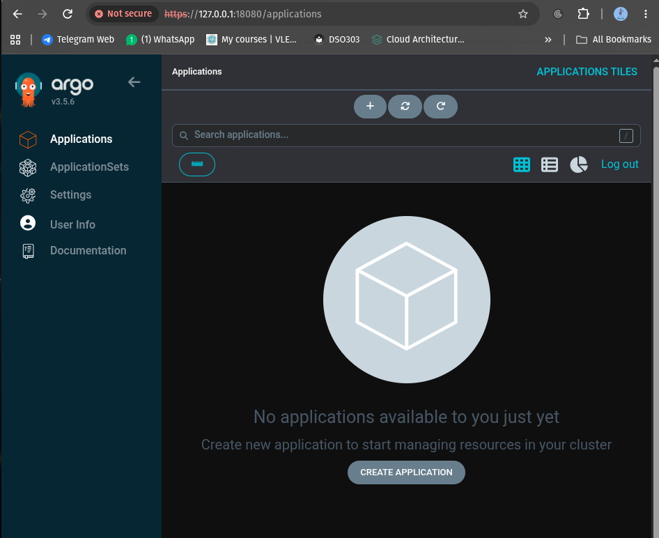

<!--
File        : docs/evidence.md
Assignment  : DSO202 Assignment 4
Purpose     : Records command outputs and verification evidence for each task.
-->

# DSO202 Assignment 4 — Evidence

## Task 1

### Repository, Chart Contract and Cluster

The Assignment 4 repository reuses the Helm chart from
Assignment 3, resource restrictions from Assignment 2,
and the Kind cluster configuration from Practical 1.

The namespace-scoped Role and RoleBinding manifests were
recreated because the original Assignment 2 RBAC manifests
were unavailable in the local assignment files.

### Chart Contract Verification

All chart file paths below are relative to charts/tasktracker/
unless otherwise stated.

| ID | Requirement | File and key | Result |
|---|---|---|---|
| C1 | Configurable image repositories and tags | values.yaml: database.image, backend.image, frontend.image; corresponding workload templates | PASS |
| C2 | Per-tier configuration rendered from values | values.yaml: database.env, backend.env, frontend.env; templates/configmap.yaml and workload envFrom references | PASS |
| C3 | Existing Secret references without rendering Secrets | values.yaml: existingSecret; templates/backend-deploy.yaml and templates/db-statefulset.yaml: secretKeyRef | PASS |
| C4 | Readiness probes on all three tiers | templates/backend-deploy.yaml: readinessProbe.httpGet.path=/api/status; templates/frontend-deploy.yaml: readinessProbe; templates/db-statefulset.yaml: readinessProbe.exec | PASS |
| C5 | Workload sync waves | templates/db-statefulset.yaml: wave 0; templates/backend-deploy.yaml: wave 1; templates/frontend-deploy.yaml: wave 2 | PASS |
| C6 | Rollout deadlines | templates/backend-deploy.yaml and templates/frontend-deploy.yaml: progressDeadlineSeconds=120 | PASS |
| C7 | Explicit resource requests and limits | values.yaml: database.resources, backend.resources, frontend.resources; corresponding workload templates | PASS |
| C8 | No platform resources rendered | templates/ contains only workload and application configuration resources; platform restrictions remain in platform/dev/ and platform/staging/ | PASS |
| C9 | Ingress disabled | values.yaml: ingress.enabled=false; no Ingress template or rendered Ingress | PASS |
| C10 | Environment-specific NodePorts | templates/frontend-deploy.yaml: service type and nodePort; environments/dev/values.yaml: 30080; environments/staging/values.yaml: 30081 | PASS |
| C11 | Helm lint and template rendering | Both environment values files successfully validated using helm lint and helm template | PASS |

The chart contract was verified through static rendering.
Live application readiness and rollout behaviour are tested
in the later deployment tasks.


### Tool Verification (Section 3.2)

```text
$ docker version --format "{{.Server.Version}}"
27.5.1

$ kind version
kind v0.32.0 go1.26.5 linux/amd64

$ kubectl version --client
Client Version: v1.36.3
Kustomize Version: v5.8.1

$ helm version --short
v4.3.0+gbec5b06

$ git --version
git version 2.34.1

$ argocd version --client
argocd: v3.5.6+c2b1e30
  BuildDate: 2026-10-20T19:01:52Z
  GitCommit: c2b1e3017e2cec86b122172e861dcd026453ae44
  GitTreeState: clean
  GoVersion: go1.26.10
  Compiler: gc
  Platform: linux/amd64

$ kubeseal --version
kubeseal version: 0.40.0

$ helm repo list
NAME          	URL                                     
hashicorp     	https://helm.releases.hashicorp.com     
kong          	https://charts.konghq.com               
bitnami       	https://charts.bitnami.com/bitnami      
podinfo       	https://stefanprodan.github.io/podinfo  
dso202-argo   	https://argoproj.github.io/argo-helm    
sealed-secrets	https://bitnami.github.io/sealed-secrets

$ helm search repo sealed-secrets/sealed-secrets --versions | head -5
NAME                         	CHART VERSION	APP VERSION	DESCRIPTION                                  
sealed-secrets/sealed-secrets	2.22.0       	0.41.2     	Helm chart for the sealed-secrets controller.
sealed-secrets/sealed-secrets	2.21.0       	0.41.2     	Helm chart for the sealed-secrets controller.
sealed-secrets/sealed-secrets	2.20.0       	0.40.0     	Helm chart for the sealed-secrets controller.
sealed-secrets/sealed-secrets	2.19.3       	0.39.1     	Helm chart for the sealed-secrets controller.
```

### Repository History

```text
$ git log --oneline --reverse
be2c43d chore: add gitignore to protect secrets and key material
089e074 docs: initialize DSO202 GitOps repository

$ git remote -v
origin	https://github.com/Namgay282004/dso202-gitops.git (fetch)
origin	https://github.com/Namgay282004/dso202-gitops.git (push)
```

### Kind Cluster Verification

```text
$ kind get clusters
dso202-gitops
kind

$ kubectl config current-context
kind-dso202-gitops

$ kubectl get nodes
NAME            STATUS   ROLES           AGE   VERSION
control-plane   Ready    control-plane   16d   v1.36.1
worker-node-1   Ready    <none>          16d   v1.36.1
worker-node-2   Ready    <none>          16d   v1.36.1

$ docker ps --filter name=dso202-gitops
dso202-gitops-worker2 
dso202-gitops-control-plane 127.0.0.1:30080->30080/tcp, 127.0.0.1:43441->6443/tcp
dso202-gitops-worker 
```

### Helm Lint and Template Verification

#### Environment: dev

```text
$ helm lint charts/tasktracker -f environments/dev/values.yaml
==> Linting charts/tasktracker
[INFO] Chart.yaml: icon is recommended

1 chart(s) linted, 0 chart(s) failed

$ helm template tasktracker charts/tasktracker --namespace dso202-dev -f environments/dev/values.yaml

$ grep "^kind:" rendered-manifest | sort | uniq -c
      3 kind: ConfigMap
      2 kind: Deployment
      3 kind: Service
      1 kind: StatefulSet
```

#### Environment: staging

```text
$ helm lint charts/tasktracker -f environments/staging/values.yaml
==> Linting charts/tasktracker
[INFO] Chart.yaml: icon is recommended

1 chart(s) linted, 0 chart(s) failed

$ helm template tasktracker charts/tasktracker --namespace dso202-staging -f environments/staging/values.yaml

$ grep "^kind:" rendered-manifest | sort | uniq -c
      3 kind: ConfigMap
      2 kind: Deployment
      3 kind: Service
      1 kind: StatefulSet
```


### Detailed Chart Contract Checks

#### Environment: dev

```text
$ grep -E "^[[:space:]]+image:" rendered-manifest
          image: "02230290namgay/dso202-backend:1.0"
          image: "02230290namgay/dso202-frontend:1.0"
          image: "02230290namgay/dso202-db:1.0"

$ grep -A 10 readinessProbe: rendered-manifest
          readinessProbe:
            httpGet:
              path: /api/status
              port: http
            initialDelaySeconds: 5
            periodSeconds: 5
            timeoutSeconds: 3
            failureThreshold: 3

          resources:
            limits:
--
          readinessProbe:
            httpGet:
              path: /
              port: http
            initialDelaySeconds: 5
            periodSeconds: 5
            timeoutSeconds: 3
            failureThreshold: 3

          resources:
            limits:
--
          readinessProbe:
            exec:
              command:
                - sh
                - -c
                - 'pg_isready -h 127.0.0.1 -U "$POSTGRES_USER" -d "$POSTGRES_DB"'
            initialDelaySeconds: 5
            periodSeconds: 5
            timeoutSeconds: 3
            failureThreshold: 6


$ grep sync-wave annotations and resource names
kind: ConfigMap
  name: tasktracker-database-config
    argocd.argoproj.io/sync-wave: "-1"
kind: ConfigMap
  name: tasktracker-backend-config
    argocd.argoproj.io/sync-wave: "-1"
kind: ConfigMap
  name: tasktracker-frontend-config
    argocd.argoproj.io/sync-wave: "-1"
kind: Service
  name: tasktracker-backend-service
    argocd.argoproj.io/sync-wave: "1"
kind: Service
  name: tasktracker-db-service
    argocd.argoproj.io/sync-wave: "0"
kind: Service
  name: tasktracker-frontend-service
    argocd.argoproj.io/sync-wave: "2"
kind: Deployment
  name: tasktracker-backend-deployment
    argocd.argoproj.io/sync-wave: "1"
kind: Deployment
  name: tasktracker-frontend-deployment
    argocd.argoproj.io/sync-wave: "2"
kind: StatefulSet
  name: tasktracker-db
    argocd.argoproj.io/sync-wave: "0"

$ grep progressDeadlineSeconds: rendered-manifest
  progressDeadlineSeconds: 120
  progressDeadlineSeconds: 120

$ grep -A 6 resources: rendered-manifest
          resources:
            limits:
              cpu: 500m
              memory: 512Mi
            requests:
              cpu: 200m
              memory: 256Mi
--
          resources:
            limits:
              cpu: 500m
              memory: 512Mi
            requests:
              cpu: 200m
              memory: 256Mi
--
          resources:
            limits:
              cpu: 500m
              memory: 512Mi
            requests:
              cpu: 200m
              memory: 256Mi
--
        resources:
          requests:
            storage: 1Gi

  persistentVolumeClaimRetentionPolicy:
    whenDeleted: Retain
    whenScaled: Retain

$ grep -A 2 secretKeyRef: rendered-manifest
                secretKeyRef:
                  name: "tasktracker-credentials"
                  key: DB_USER
--
                secretKeyRef:
                  name: "tasktracker-credentials"
                  key: DB_PASSWORD
--
                secretKeyRef:
                  name: "tasktracker-credentials"
                  key: POSTGRES_USER
--
                secretKeyRef:
                  name: "tasktracker-credentials"
                  key: POSTGRES_PASSWORD

$ grep NodePort configuration
  type: NodePort
      nodePort: 30080

$ Check forbidden resource kinds
PASS: No forbidden resources rendered
```

#### Environment: staging

```text
$ grep -E "^[[:space:]]+image:" rendered-manifest
          image: "02230290namgay/dso202-backend:1.0"
          image: "02230290namgay/dso202-frontend:1.0"
          image: "02230290namgay/dso202-db:1.0"

$ grep -A 10 readinessProbe: rendered-manifest
          readinessProbe:
            httpGet:
              path: /api/status
              port: http
            initialDelaySeconds: 5
            periodSeconds: 5
            timeoutSeconds: 3
            failureThreshold: 3

          resources:
            limits:
--
          readinessProbe:
            httpGet:
              path: /
              port: http
            initialDelaySeconds: 5
            periodSeconds: 5
            timeoutSeconds: 3
            failureThreshold: 3

          resources:
            limits:
--
          readinessProbe:
            exec:
              command:
                - sh
                - -c
                - 'pg_isready -h 127.0.0.1 -U "$POSTGRES_USER" -d "$POSTGRES_DB"'
            initialDelaySeconds: 5
            periodSeconds: 5
            timeoutSeconds: 3
            failureThreshold: 6


$ grep sync-wave annotations and resource names
kind: ConfigMap
  name: tasktracker-database-config
    argocd.argoproj.io/sync-wave: "-1"
kind: ConfigMap
  name: tasktracker-backend-config
    argocd.argoproj.io/sync-wave: "-1"
kind: ConfigMap
  name: tasktracker-frontend-config
    argocd.argoproj.io/sync-wave: "-1"
kind: Service
  name: tasktracker-backend-service
    argocd.argoproj.io/sync-wave: "1"
kind: Service
  name: tasktracker-db-service
    argocd.argoproj.io/sync-wave: "0"
kind: Service
  name: tasktracker-frontend-service
    argocd.argoproj.io/sync-wave: "2"
kind: Deployment
  name: tasktracker-backend-deployment
    argocd.argoproj.io/sync-wave: "1"
kind: Deployment
  name: tasktracker-frontend-deployment
    argocd.argoproj.io/sync-wave: "2"
kind: StatefulSet
  name: tasktracker-db
    argocd.argoproj.io/sync-wave: "0"

$ grep progressDeadlineSeconds: rendered-manifest
  progressDeadlineSeconds: 120
  progressDeadlineSeconds: 120

$ grep -A 6 resources: rendered-manifest
          resources:
            limits:
              cpu: 500m
              memory: 512Mi
            requests:
              cpu: 200m
              memory: 256Mi
--
          resources:
            limits:
              cpu: 500m
              memory: 512Mi
            requests:
              cpu: 200m
              memory: 256Mi
--
          resources:
            limits:
              cpu: 500m
              memory: 512Mi
            requests:
              cpu: 200m
              memory: 256Mi
--
        resources:
          requests:
            storage: 1Gi

  persistentVolumeClaimRetentionPolicy:
    whenDeleted: Retain
    whenScaled: Retain

$ grep -A 2 secretKeyRef: rendered-manifest
                secretKeyRef:
                  name: "tasktracker-credentials"
                  key: DB_USER
--
                secretKeyRef:
                  name: "tasktracker-credentials"
                  key: DB_PASSWORD
--
                secretKeyRef:
                  name: "tasktracker-credentials"
                  key: POSTGRES_USER
--
                secretKeyRef:
                  name: "tasktracker-credentials"
                  key: POSTGRES_PASSWORD

$ grep NodePort configuration
  type: NodePort
      nodePort: 30081

$ Check forbidden resource kinds
PASS: No forbidden resources rendered
```

### C2 — Configurable Backend Environment Test

```text
$ helm template with backend.env.GITOPS_CONTRACT_TEST=verified
  GITOPS_CONTRACT_TEST: "verified"

$ grep -A 3 envFrom: rendered-manifest
          envFrom:
            - configMapRef:
                name: tasktracker-backend-config

--
          envFrom:
            - configMapRef:
                name: tasktracker-frontend-config

--
          envFrom:
            - configMapRef:
                name: tasktracker-database-config


$ Check that the temporary test value is not saved
PASS: Test value was only used during rendering
```

### Repository Security Verification

| Security check | Result |
|---|---|
| All eight gitignore protection tests | PASS |
| Sensitive filename search | No matching files |
| Plaintext Secret manifest search | No matches |
| Private key search | No matches |
| Previous credential value search | No matches |
| Potential hardcoded credential search | No matches |
| Reachable Git history credential search | No matches |

The initial Git history was inspected before committing
the application configuration.

Actual verification output:

```text
===== CORRECTED PRIVATE KEY SEARCH =====
PASS: No private keys found

===== GIT HISTORY CREDENTIAL SEARCH =====
===== GIT HISTORY FILES =====
.gitignore
README.md
```

These checks reduce the risk of accidentally exposing plaintext
credentials and private key material in the public repository.
They are not a guarantee that every possible secret format has
been detected.


---

## Task 2 — Install Argo CD Declaratively

### 1. Objective

Install Argo CD using a version-controlled Kustomize configuration
with a pinned upstream release and local configuration patches.

Mapped descriptors: 4.1.2, 4.2.1, Unit III 3.1.4.
Learning outcomes: LO 6 and LO 7.

### 2. Declarative bootstrap configuration

| File | Purpose |
|---|---|
| bootstrap/argocd/namespace.yaml | Creates the argocd namespace |
| bootstrap/argocd/kustomization.yaml | References the pinned Argo CD v3.5.6 installation |
| bootstrap/argocd/argocd-cm-patch.yaml | Configures reconciliation, reviewer login and Application health |
| bootstrap/argocd/argocd-rbac-cm-patch.yaml | Defines the restricted reviewer permissions and empty default policy |

The upstream installation manifest is pinned to:

https://raw.githubusercontent.com/argoproj/argo-cd/v3.5.6/manifests/install.yaml

### 3. Kustomize rendering verification

Command:

```bash
kubectl kustomize bootstrap/argocd > /tmp/argocd-rendered.yaml
wc -l /tmp/argocd-rendered.yaml
```

Actual output:

```text
34132 /tmp/argocd-rendered.yaml
```

#### 3.1 Rendered workload kinds

Command:

```bash
grep -E '^kind: (Deployment|StatefulSet)$' /tmp/argocd-rendered.yaml
```

Actual output:

```text
kind: Deployment
kind: Deployment
kind: Deployment
kind: Deployment
kind: Deployment
kind: Deployment
kind: StatefulSet
```

Workload count:

```bash
grep -E '^kind: (Deployment|StatefulSet)$' \
  /tmp/argocd-rendered.yaml | sort | uniq -c
```

```text
      6 kind: Deployment
      1 kind: StatefulSet
```

Result: PASS. Six Deployments and one StatefulSet were rendered.

#### 3.2 Rendered container images

Command:

```bash
grep 'image:' /tmp/argocd-rendered.yaml | sort -u
```

Actual output:

```text
        image: ghcr.io/dexidp/dex:v2.45.1
        image: public.ecr.aws/docker/library/redis:8.2.3-alpine
        image: quay.io/argoproj/argocd:v3.5.6
```

Result: PASS. All three images use explicit version tags and the
expected image registries. None is retrieved from Docker Hub.

#### 3.3 Namespace verification

Command:

```bash
grep -E '^  namespace:' \
  /tmp/argocd-rendered.yaml | sort | uniq -c
```

Actual output:

```text
     59   namespace: argocd
```

All namespace declarations matched by the command reference argocd.

#### 3.4 Rendered configuration patches

Actual output:

```yaml
accounts.reviewer: login
resource.customizations.health.argoproj.io_Application: |
timeout.reconciliation: 60s
timeout.reconciliation.jitter: 10s
```

Rendered RBAC configuration excerpt:

```text
p, reviewer, applications, get, dso202/*, allow
p, reviewer, projects, get, dso202, allow
policy.default: ""
```

Result: PASS. The expected configuration patches are present.

### 4. Server-side installation

Installation command:

```bash
kubectl apply -k bootstrap/argocd \
  --server-side --force-conflicts
```

Server-side apply was used because the ApplicationSet CRD exceeds
the 262144-byte annotation size limit associated with ordinary
client-side apply.

The installation was verified through Deployment availability,
StatefulSet readiness, running Pods and registered CRDs.

### 5. Workload readiness verification

Command:

```bash
kubectl wait --for=condition=Available deployment --all \
  -n argocd --timeout=300s
```

Final successful output:

```text
deployment.apps/argocd-applicationset-controller condition met
deployment.apps/argocd-dex-server condition met
deployment.apps/argocd-notifications-controller condition met
deployment.apps/argocd-redis condition met
deployment.apps/argocd-repo-server condition met
deployment.apps/argocd-server condition met
```

StatefulSet verification:

```bash
kubectl rollout status \
  statefulset/argocd-application-controller \
  -n argocd --timeout=300s
```

Actual output:

```text
partitioned roll out complete: 1 new pods have been updated...
```

#### 5.1 Final Pod status

Command:

```bash
kubectl get pods -n argocd
```

Actual output:

```text
NAME                                                READY   STATUS    RESTARTS   AGE
argocd-application-controller-0                     1/1     Running   0          19m
argocd-applicationset-controller-58bb5c7479-48nwb   1/1     Running   0          19m
argocd-dex-server-dd6b85d9c-hwj74                   1/1     Running   0          19m
argocd-notifications-controller-6b85c65458-qts6z    1/1     Running   0          19m
argocd-redis-869b85489d-7f9wl                       1/1     Running   0          19m
argocd-repo-server-5bf66565cd-98k2t                 1/1     Running   0          19m
argocd-server-7474bb8f76-gtmlm                      1/1     Running   0          19m
```

Result: PASS. All seven Pods are Running and Ready with zero restarts.

#### 5.2 CRD verification

Command:

```bash
kubectl get crd | grep argoproj.io
```

Actual output:

```text
applications.argoproj.io      2026-11-21T19:10:55Z
applicationsets.argoproj.io   2026-11-21T19:10:55Z
appprojects.argoproj.io       2026-11-21T19:10:56Z
```

Result: PASS. All three required CRDs exist.

### 6. Argo CD access and authentication

The following port-forward command was used:

```bash
kubectl port-forward --address 127.0.0.1 \
  svc/argocd-server -n argocd 18080:443
```

CLI authentication command:

```bash
argocd login 127.0.0.1:18080 --username admin --insecure
```

Authentication verification:

```bash
argocd account get-user-info
```

Actual output:

```text
Logged In: true
Username: admin
Issuer: argocd
Groups:
```

Browser access:

https://127.0.0.1:18080/applications

The self-signed TLS certificate warning was accepted for the local
installation. No credentials are included in the evidence.

#### 6.1 Authenticated Argo CD dashboard



The dashboard displayed Argo CD v3.5.6 and an empty Applications
view. This is expected because the root Application and AppProjects
are created in Task 3.

### 7. Applied configuration verification

Command:

```bash
kubectl get configmap argocd-cm -n argocd -o yaml \
  | grep -E 'timeout.reconciliation|accounts.reviewer|resource.customizations.health'
```

Actual output:

```yaml
  accounts.reviewer: login
  resource.customizations.health.argoproj.io_Application: |
  timeout.reconciliation: 60s
  timeout.reconciliation.jitter: 10s
```

Result: PASS. The expected settings are present in the running
Argo CD installation.

#### 7.1 Applied RBAC configuration

Command:

```bash
kubectl get configmap argocd-rbac-cm -n argocd -o yaml \
  | grep -E 'policy.default:|p, reviewer,'
```

Actual output:

```text
    p, reviewer, applications, get, dso202/*, allow
    p, reviewer, projects, get, dso202, allow
  policy.default: ""
```

Result: PASS. The configured reviewer permissions match the
bootstrap policy. Permission enforcement will be tested in Task 6.

### 8. Argo CD version verification

Command:

```bash
argocd version
```

Actual output:

```text
argocd: v3.5.6+c2b1e30
  BuildDate: 2026-10-20T19:01:52Z
  GitCommit: c2b1e3017e2cec86b122172e861dcd026453ae44
  GitTreeState: clean
  GoVersion: go1.26.10
  Compiler: gc
  Platform: linux/amd64
argocd-server: v3.5.6
  BuildDate: 2026-10-20T18:33:20Z
  GitCommit: c2b1e3017e2cec86b122172e861dcd026453ae44
  GitTreeState: clean
  GitTag: v3.5.6
  GoVersion: go1.26.10
  Compiler: gc
  Platform: linux/amd64
  Kustomize Version: v5.8.1 2026-02-09T16:15:27Z
  Helm Version: v4.2.1+gd591a19
  Kubectl Version: v0.36.1
  Jsonnet Version: v0.22.0
```

Result: PASS. Both the Argo CD client and server use v3.5.6
and the same Git commit.

### 9. Troubleshooting and environmental observations

#### 9.1 Docker memory allocation

Docker reported 3.675 GiB of available VM memory, below the
recommended 6 GB allocation.

An unused Kind cluster was stopped without deleting it. This
released approximately 1.88 GiB of reported container memory.

The Assignment 4 cluster retained all three Ready nodes.
Docker memory allocation was not changed.

During Argo CD initialization, the three Assignment 4 node
containers reported the following memory usage:

| Node | Memory usage |
|---|---:|
| Control plane | 952.8 MiB |
| Worker node 1 | 378.7 MiB |
| Worker node 2 | 325.4 MiB |
| Total | 1656.9 MiB |

No warning events were reported during the diagnostic check.
The lower Docker memory allocation remains a consideration
for subsequent application deployments.

#### 9.2 Initial Deployment readiness timeout

The initial 300-second readiness check timed out while
container images were still downloading.

Six Pods eventually became Running and Ready, while the Dex
server remained in PodInitializing.

Pod inspection confirmed:

- The Pod was successfully scheduled on worker-node-2.
- The copyutil init container completed with exit code 0.
- The Dex container image was still downloading.
- No container restarts or warning events were reported.

The final Kubernetes events recorded these image pull durations:

| Image | Pull duration |
|---|---|
| Argo CD v3.5.6 (Dex init container) | 4m25.589s |
| Redis 8.2.3-alpine | 56.022s |
| Dex v2.45.1 | 11m30.238s |

Corrective action:

```bash
kubectl wait --for=condition=Available \
  deployment/argocd-dex-server \
  -n argocd --timeout=600s
```

Actual output:

```text
deployment.apps/argocd-dex-server condition met
```

The final readiness check confirmed all seven Pods were
Running and Ready with zero restarts.

No manifest changes, Pod deletion or cluster recreation
were required.

#### 9.3 Local port conflicts

The original local port 8080 was occupied by the existing
model-router Docker container.

```text
model-router    0.0.0.0:8080->80/tcp
```

The alternative port 8081 was also occupied by a docker-proxy
process.

The following ports were checked:

```text
Port 8080: OCCUPIED
Port 8081: OCCUPIED
Port 8082: OCCUPIED
Port 8083: OCCUPIED
Port 8085: AVAILABLE
Port 8888: AVAILABLE
Port 9090: AVAILABLE
Port 18080: AVAILABLE
```

Local port 18080 was selected for Argo CD access, preserving
the existing applications and services.

Binding explicitly to 127.0.0.1 also avoided the IPv6
listener error.

This change affects only local port forwarding. It does not
modify the Kubernetes Service, Argo CD manifests or GitOps
architecture.

### 10. Task 2 verification summary

| Requirement | Result |
|---|---|
| Version-controlled Kustomize bootstrap | PASS |
| Pinned Argo CD release v3.5.6 | PASS |
| Six rendered Deployments | PASS |
| One rendered StatefulSet | PASS |
| Expected container images | PASS |
| Server-side installation | PASS |
| Seven Running and Ready Pods | PASS |
| Three required CRDs | PASS |
| CLI authentication | PASS |
| Browser authentication | PASS |
| Applied ConfigMap settings | PASS |
| Applied reviewer RBAC configuration | PASS |
| Client and server version verification | PASS |
| Required authenticated UI screenshot | PASS |

### 11. Conclusion

Argo CD v3.5.6 was installed declaratively using Kustomize
and server-side apply on the existing dso202-gitops Kind
cluster.

All seven components are healthy, the required CRDs exist,
and the local configuration patches are present.

Both CLI and browser authentication were verified.
The initial image download delay and local port conflicts
were resolved without modifying the installation or
disrupting existing applications.

The Argo CD installation is ready for Task 3, which introduces
AppProjects and the root Application.

